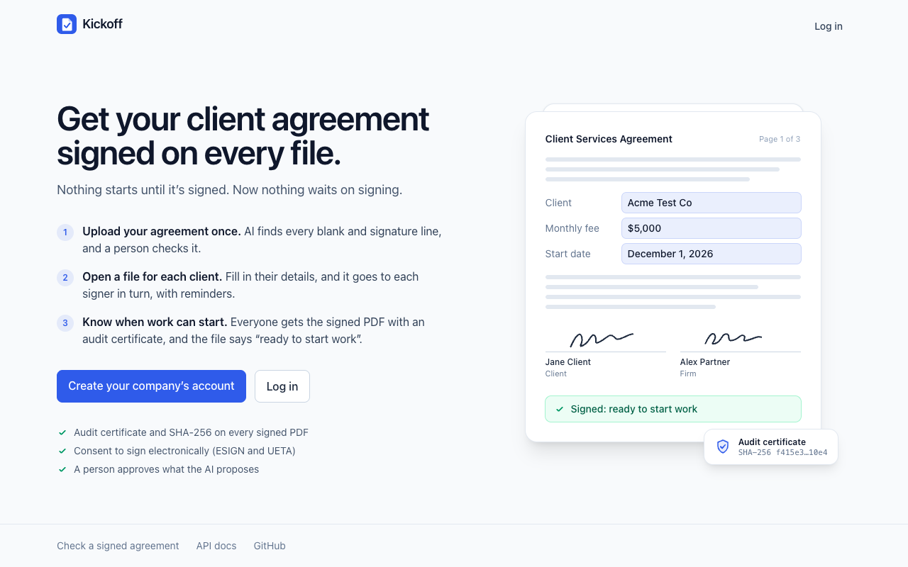
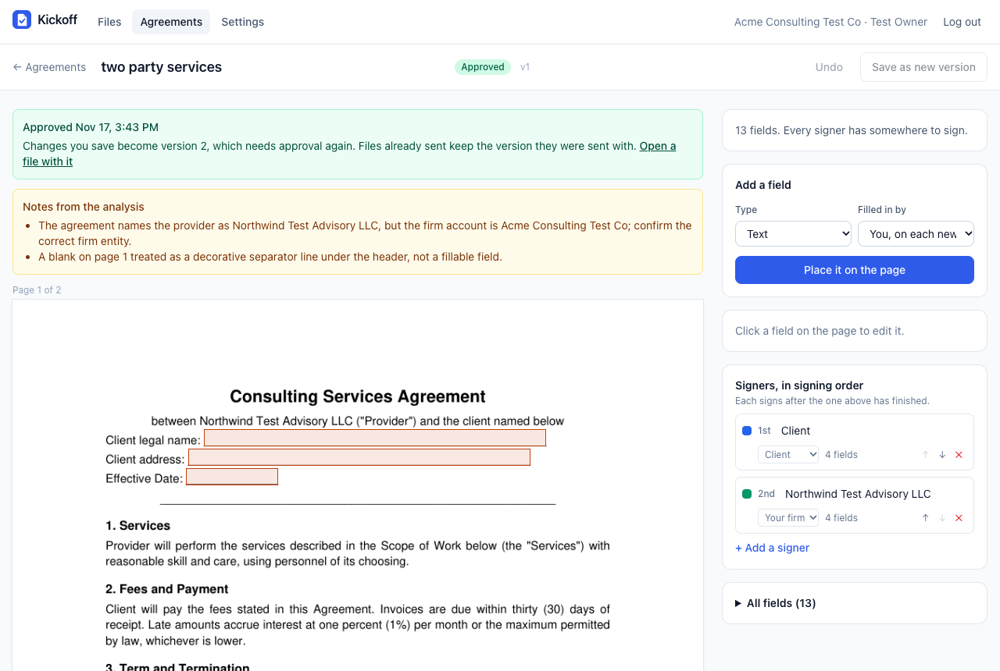
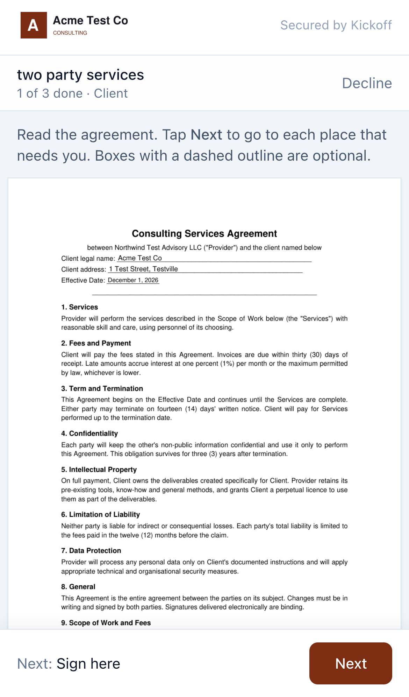
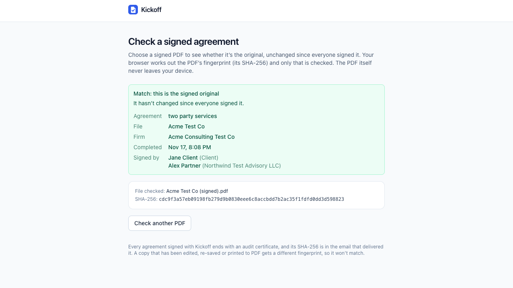
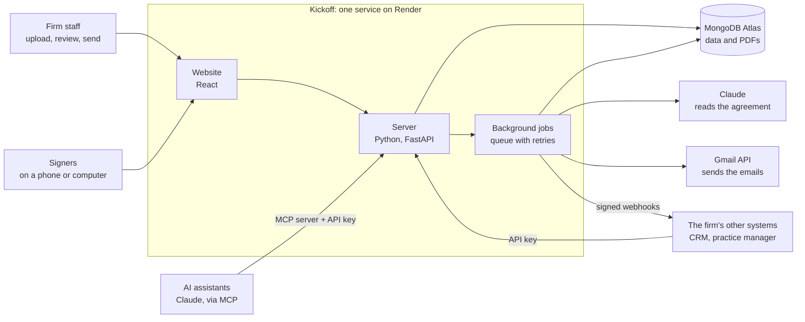
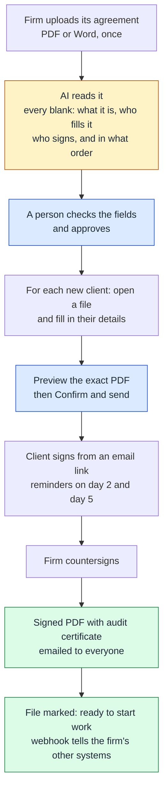

# Kickoff: get your client agreement signed on every file

A firm uploads its standard client agreement once. AI finds where every blank and signature goes, and a person confirms it. From then on, every new file sends a pre-filled agreement to the right people, chases them until they sign, and returns a signed, tamper-evident PDF. It then tells the firm's other systems that work can start.

**Live app:** https://kickoff-r713.onrender.com

## What it does

1. **Upload your agreement once,** as a PDF or Word (.docx) file. Claude proposes every blank and signature line, and who fills each one: the firm, or which signer. A person checks the fields in the editor, adjusts them if needed, and approves. A scanned agreement gets a signature page, and fields can be placed by hand.
2. **Open a file for each client.** Fill in that client's details, look over the exact PDF, and send it. Every client you send to is saved, so next time you pick them from the **Client** search and their name, email, company and address fill in. The job's dates and fees, and the firm's own details, are never copied from an old file. Saved clients can be corrected or deleted from Settings.
3. **Signers sign in order,** from an emailed link, on a phone or a computer. They agree to sign electronically, fill in their parts, and type or draw a signature. Reminders go out on day 2 and day 5, and links expire after 30 days. The firm can copy a signing link, resend, correct an email address, or void the file.
4. **The Files page shows where everything stands:** what's waiting on others, what's waiting on you, what was signed this week, and the average time to sign. A search box finds any file by client, title or agreement.
5. **Everyone gets the signed PDF** with an audit certificate showing who signed, when, from where, and the SHA-256 fingerprints. The file shows "Signed: ready to start work". Anyone can check a copy at [/verify](https://kickoff-r713.onrender.com/verify): the browser works out the PDF's fingerprint, so the PDF never leaves their device.
6. **Other systems can join in.** With an API key, a CRM or practice manager can open files. Signed webhooks report when each file is sent, signed and complete.
7. **A whole team can use it.** Invite colleagues from Settings. Each gets their own login (with their own name and password, changed in Settings), and every file shows who sent it. Settings also sets the firm's logo and colour, which signers see on their emails and the signing page.
8. **AI assistants can use it too.** The [Kickoff MCP server](mcp-server/README.md) lets Claude (or any MCP client) prepare a draft for a client, say which agreements are still waiting, and save the signed PDF. A person still checks and sends every draft.

## Screenshots

All screenshots are from the live app, with test data.

**The landing page**



**Reviewing a new agreement:** Claude's proposed fields, ready for a person to approve



**Signing on a phone,** in the firm's own logo and colour

<p align="center"></p>

**Checking a signed copy** on the public verify page



## Try it

1. Open the [live app](https://kickoff-r713.onrender.com) and create an account (any company name).
2. Upload an agreement. Analysis takes from about 10 seconds to 2 minutes, depending on its length.
3. Check the proposed fields and press **Approve**.
4. **Files → New file:** enter the signers and the client's details, then **Preview the agreement → Confirm and send**.
5. Each signer gets an email in the firm's name. The first one may land in spam, so check there. You can also press **Copy signing link** on the file page and send the link yourself. When it's your own turn to countersign, press **Sign now** on the file page; you don't need the email.
6. When everyone has signed, the file page offers **Download signed agreement**. Anyone can check a copy at **/verify**.

## API and webhooks

In **Settings**, create an API key and set a webhook address. The full reference is at [`/api/docs`](https://kickoff-r713.onrender.com/api/docs).

```bash
# Your approved agreements, with each signer's role and the details a file fills in
curl https://kickoff-r713.onrender.com/api/v1/templates -H "Authorization: Bearer $KICKOFF_KEY"

# Open a file. It waits as a draft until someone at the firm checks the preview and sends it.
curl https://kickoff-r713.onrender.com/api/v1/files \
  -H "Authorization: Bearer $KICKOFF_KEY" -H "Idempotency-Key: matter-1042" \
  -H "Content-Type: application/json" \
  -d '{"template_id": "<id>", "signers": [{"role": "client", "name": "Jane Client", "email": "jane@example.com"}],
       "values": {"client_name": "Acme Test Co"}, "metadata": {"matter_id": "1042"}}'
```

- **Webhook events:** `file.sent`, `signer.signed`, `file.completed` (the signed PDF is ready), `file.declined`, `file.voided` and `file.expired`. Each event carries the file and your `metadata`.
- **Checking a webhook came from Kickoff:** each delivery has `X-Kickoff-Signature: t=<unix time>,v1=<hex>`. Compute an HMAC-SHA256 of `t + "." + raw body` with your signing secret, compare it with `v1`, and reject anything more than 5 minutes old.
- **Failures:** a failed delivery is retried for about an hour and a half. Settings shows a log of every delivery, with **Retry** on any that gave up.

### AI assistants (MCP)

The [Kickoff MCP server](mcp-server/README.md) is a small add-on for Claude Desktop, Claude Code or any MCP client. It runs on your computer with your API key. Ask *"Send our client agreement to Jane at Acme"* and it prepares a draft and gives you the link to check and send it. Ask *"Which agreements are still waiting?"* to see who each one is waiting for, or *"Save the signed Acme agreement"* to download it. It can prepare drafts, but it can't send them. Setup takes about 2 minutes; see [mcp-server/README.md](mcp-server/README.md).

## Status

Everything above is live. Before release I ran two blind-test rounds on nine public agreements the system had never seen, each taken from upload to signed PDF on the live app; the results are in the DECISIONS.md change log. Known limitations, and what production would need, are under "Known limitations" in [DECISIONS.md](DECISIONS.md).

## Tech stack

| Part | Built with |
|---|---|
| Backend | Python 3.13, FastAPI, Pydantic, PyMongo (async), uvicorn, httpx, argon2 (passwords) |
| Documents | PyMuPDF (reading, filling and finishing PDFs), LibreOffice (Word to PDF) |
| AI | The Claude API (`claude-opus-5-5`) through the Anthropic Python SDK |
| Frontend | React, TypeScript, Vite, Tailwind CSS, TanStack Query, React Router, signature_pad |
| Data and files | MongoDB Atlas, with GridFS for documents |
| Email | Gmail API |
| MCP server | The official MCP Python SDK |
| Hosting and operations | Docker on Render, Sentry (errors), UptimeRobot (uptime), GitHub Actions (CI) |
| Testing and checks | pytest, ruff, mypy, oxlint; Playwright driving Chrome for end-to-end checks (not committed) |
| Package managers | uv (Python), npm (frontend) |

## Further reading

- [SUBMISSION.md](SUBMISSION.md): what's included, what's left out, and why.
- [DECISIONS.md](DECISIONS.md): every design decision, the blind-test results and the known limitations.

## How it works

Kickoff is one web app with three parts: a **website** that people click, a **server** that does the work, and a **database**. Anything slow, or that talks to the outside world (the AI, email, other systems), runs as a **background job** that retries until it succeeds. A slow AI response or a hiccup at Gmail never breaks what someone is doing.

### The parts



### One agreement's journey

The AI does one job, once per agreement: it works out what each blank is and who fills it in. A person approves that before it's ever used. Everything after that is ordinary, predictable software, because signatures and their audit trail have to behave the same way every time.



Yellow is the AI step, blue is where a person confirms, and green is the result.

### Where things are in the code

```text
client-agreement-automation/
├── README.md               You are here: what it does and how to try it
├── DECISIONS.md            Why it's built this way: what's included, what's left out, and why
├── SUBMISSION.md           The submission summary: what's included and left out
├── PRIVACY.md, TERMS.md    Privacy notice and terms (also needed for the Gmail sending account)
├── docs/screenshots/       The screenshots in this README
├── Dockerfile, render.yaml How it's packaged and deployed
│
├── frontend/src/           THE WEBSITE
│   ├── pages/              One file per screen: landing, sign-up, upload, review, files,
│   │                       new file, saved clients, file page, signing page, verify page,
│   │                       settings
│   └── components/         Shared pieces: the field editor, the signature pad
│
├── mcp-server/            THE MCP ADD-ON: lets AI assistants prepare drafts and track signatures
│
└── backend/                THE SERVER
    ├── app/api/            The server's entry points, one file per area
    │                       (sign-up, agreements, files, signing, settings, public API)
    ├── app/services/       The work itself:
    │   ├── detection/      The AI step: asks Claude what each blank is (keyword rules as a fallback)
    │   ├── pdf_engine.py   Reads PDFs, finds blanks, writes values, adds the certificate
    │   ├── templates.py    Upload, analyze, review, approve
    │   ├── files.py        Open a file, preview, send, resend, void
    │   ├── clients.py      Saved clients: saved on send, picked on New file
    │   ├── signing.py      Signing order, the signer's steps, reminders, expiry
    │   ├── finalize.py     The signed PDF, its certificate and fingerprints, emailed to everyone
    │   ├── email/          The email texts, sent through Gmail
    │   ├── branding.py     The firm's logo and colour on signing emails and the signing page
    │   └── webhooks.py     Telling the firm's other systems (plus apikeys.py for the API)
    ├── app/worker/         The background job queue: retries, then shows a way out if a job fails
    ├── app/repo.py         The only way to read the database, so one firm never sees another's data
    ├── tests/              Automatic tests, run on every change (GitHub Actions)
    └── evals/              Sample agreements that measure how well the AI finds blanks
```

| Step in the journey | Where it happens |
|---|---|
| Upload and AI analysis | `templates.py`, `pdf_engine.py`, `detection/` |
| Review and approve | `frontend/src/components/editor/`, `templates.py` |
| Open a file, preview, send | `files.py`, `clients.py`, `pdf_engine.py` |
| Emails, reminders, signing | `signing.py`, `email/`, `frontend/src/pages/SignPage.tsx` |
| Signed PDF and certificate | `finalize.py`, `pdf_engine.py` |
| Checking a copy (public) | `api/verify.py`, `frontend/src/pages/VerifyPage.tsx` |
| Telling other systems | `webhooks.py`, `api/v1.py` |
| AI assistants (MCP) | `mcp-server/kickoff_mcp/server.py` |

## Run it locally

You need Docker, [uv](https://docs.astral.sh/uv/), and Node 22 or newer.

```bash
docker run -d --name mongo -p 27017:27017 mongo:8.0        # database

cd backend
cp .env.example .env                                      # defaults work for local dev
uv sync
uv run uvicorn app.main:create_app --factory --reload --port 8000

# in another terminal
cd frontend
npm install
npm run dev                                               # http://localhost:5173
```

In dev, emails are printed to the backend log instead of being sent (`EMAIL_BACKEND=console`).

Word (.docx) uploads need LibreOffice installed locally. The Docker image includes it (`docker build -t agreement-app . && docker run --env-file backend/.env -p 8000:8000 agreement-app`).

```bash
cd backend && uv run pytest                               # tests (needs the local Mongo)
cd backend && uv run python -m evals.run --offline        # detection eval, keyword rules only (free)
cd backend && uv run python -m evals.run                  # detection eval with Claude (costs about 55 cents)
cd frontend && npm run typecheck && npm run lint && npm run build
```

To check a deployed app end to end without a Claude call, use `scripts/live_check.py`. It runs a whole file on an approved agreement and checks the signed PDF:

```bash
cd backend
LIVE_CHECK_PASSWORD=... uv run python -m scripts.live_check --base <app URL> --email <account with an approved agreement>
```

## Deploy (Render, free tier)

1. **Database:** create a free MongoDB Atlas M0 cluster and a database user. Under Network Access, allow `0.0.0.0/0` (Render's free tier has no static IPs). Copy the connection string.
2. **Email:** follow "Email setup" below.
3. **Render:** choose New → Blueprint and select this repo. `render.yaml` creates the service. Fill in the secrets it asks for: `MONGODB_URI`, `ANTHROPIC_API_KEY`, the `GMAIL_*` values, and `SENTRY_DSN`.
4. **Keep-awake:** add a free UptimeRobot HTTP monitor on `https://<your-app>.onrender.com/api/health` every 5 minutes. It keeps the free instance from sleeping, and it alerts you if anything degrades.
5. **Verify:**
   - `GET /api/health` should report every check `ok`.
   - Send yourself a test email from the deployed service:
     ```bash
     curl -X POST https://<your-app>.onrender.com/api/ops/test-email \
       -H "x-ops-token: <OPS_TOKEN from the Render dashboard>" \
       -H "content-type: application/json" -d '{"to": "you@example.com"}'
     ```

## Email setup (Gmail API, one-time, about 10 minutes)

Render's free tier blocks SMTP, so the app sends through the Gmail REST API over HTTPS from a dedicated Gmail account. The reasoning is in DECISIONS.md, D11.

1. Create (or reuse) a **dedicated** Gmail account for sending, and turn on 2-step verification.
2. In the [Google Cloud console](https://console.cloud.google.com/), create a project and enable the **Gmail API**.
3. Open **Google Auth Platform**:
   - Under **Branding**, set the app name, support email and developer contact.
     - Google won't let you publish without a home page and a privacy policy. Use the repo URL plus [PRIVACY.md](PRIVACY.md) and [TERMS.md](TERMS.md).
     - Add `github.com` under Authorized domains.
   - Under **Audience**, choose External, then **Publish app** so the status reads "In production". This matters: in "Testing" status, Google expires the refresh token after 7 days.
4. Under **Clients**, choose Create client → **Desktop app**, and copy the client ID and secret.
5. Run the following, using your own address for the test email:
   ```bash
   cd backend
   uv run python -m scripts.gmail_auth --send-test you@example.com
   ```
   - It prompts for the client ID and secret. The secret is hidden and stays out of your shell history.
   - A browser opens. Pick the **dedicated** account. Google warns that the app is unverified; choose Advanced → Continue, since it's your own app.
   - The script prints which account it connected, and sends you a test email.
6. Copy the printed `GMAIL_*` values into `backend/.env` (to send for real locally) and into Render.
